<p align="center">
  <a href="https://t3.codes">
    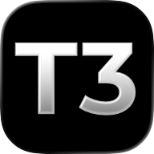
  </a>
</p>

<h1 align="center">T3 Code</h1>

<p align="center">The open-source control plane for coding agents.</p>

<p align="center">
  <a href="https://t3.codes/download"><strong>Download</strong></a> ·
  <a href="https://apps.apple.com/us/app/t3-code-remote-claude-more/id6787819824">iOS</a> ·
  <a href="https://play.google.com/store/apps/details?id=com.t3tools.t3code">Android</a> ·
  <a href="https://app.t3.codes">Web</a> ·
  <a href="./docs/README.md">Docs</a> ·
  <a href="https://discord.gg/jn4EGJjrvv">Discord</a>
</p>

<p align="center">
  <a href="https://t3.codes">
    
  </a>
</p>

> This is a fork of [pingdotgg/t3code](https://github.com/pingdotgg/t3code) with a batch of extra features on top: keeping Claude's prompt cache warm (or compacting it before it expires), a tile wall of live chats, a touch / car layout with server-side voice input, external notification cards, usage and spend meters, color themes, two-factor sessions, and more. See [What this fork adds](#what-this-fork-adds).

T3 Code runs the coding agents on your machine and gives them one fast interface. Start a thread at your desk, then approve the next step from your phone.

It works with Claude Code, Codex, Cursor, OpenCode, Grok Build, Antigravity, Kiro, Pi, Muse Code, fx, and any [ACP](./docs/user/providers-acp.md) agent. If an agent is set up on your computer, T3 Code can control it.

## What you get

- **Your subscriptions.** T3 Code does not resell tokens. It drives the agents you are already signed in to.
- **Every agent in one place.** Change models in the middle of a thread. Let Claude hand a task to Codex.
- **Desktop, web, and phone.** One server, and every client shows the same threads. There are apps for iOS and Android.
- **Remote ready.** Run agents on any machine. Connect over your local network, Tailscale, or [T3 Connect](./docs/user/remote-access.md).
- **Git built in.** Each thread can work in its own worktree. Review the diff, then commit, push, and open a pull request with one button.
- **Fast.** Performance is a feature here. We measure it, and we treat a dropped frame as a bug.
- **Open.** MIT licensed. If you don't like something, fork it.

## Install

### Desktop app

[Download T3 Code](https://t3.codes/download) for macOS, Windows, or Linux. You can also use a package manager:

| Platform       | Command                                                              |
| -------------- | -------------------------------------------------------------------- |
| macOS          | `brew install --cask t3-code`                                        |
| Windows        | `winget install T3Tools.T3Code` or `scoop install extras/t3code`     |
| Arch Linux     | `yay -S t3code-bin`                                                  |
| Nix            | `nix profile add github:NixOS/nixpkgs/nixos-unstable#t3code`         |
| Debian, Ubuntu | `.deb` from [Releases](https://github.com/pingdotgg/t3code/releases) |

### Command line

This installs the `t3` command. Run `t3` to start the server and open the web app.

```bash
curl -fsSL https://t3.codes/install.sh | sh
```

On Windows, in PowerShell:

```powershell
irm https://t3.codes/install.ps1 | iex
```

To try it once without an install, run `npx t3@latest`.

### Phone

Get the app from the [App Store](https://apps.apple.com/us/app/t3-code-remote-claude-more/id6787819824) or [Google Play](https://play.google.com/store/apps/details?id=com.t3tools.t3code). Then follow [remote access](./docs/user/remote-access.md) to connect it to your computer.

### Sign in to an agent

T3 Code needs one agent that is installed and signed in. For example, install [Claude Code](https://claude.com/product/claude-code) and run `claude auth login`, or install [Codex CLI](https://developers.openai.com/codex/cli) and run `codex login`.

[Provider setup](./docs/user/install.md#providers) has the steps for each agent. [Install T3 Code](./docs/user/install.md) covers nightly builds, AppImage, WSL, and NixOS.

## "Wait, what are you selling me?"

Nothing. We built T3 Code because we wanted the best possible development experience with agents. We were inspired by existing solutions like the Codex desktop app, Conductor, Claude Desktop and Cursor Glass, but none met our bar.

We wanted something performant, remote-ready, and truly open. If we ever go the wrong direction, we want you to have everything you need to fork and build the tool that you want.

## What this fork adds

Everything below is additive on top of upstream T3 Code. Screenshots are from a live instance. The per-device switches for most of these live on one page, **Settings → Fork Features**.

- [🔥 Keep the Claude prompt cache warm](#-keep-the-claude-prompt-cache-warm), in three modes
- [🎨 Selectable color themes](#-selectable-color-themes)
- [📊 Usage, spend & token meters in the header](#-usage-spend--token-meters-in-the-header)
- [🧱 Tile wall of live chats](#-tile-wall-of-live-chats)
- [🚗 Touch / car layout](#-touch--car-layout)
- [🎙️ Server-side voice input](#️-server-side-voice-input)
- [🔔 Notifications from outside services](#-notifications-from-outside-services)
- [🔁 Cross-chat AI restart alerts](#-cross-chat-ai-restart-alerts)
- [🗂️ "Chats by activity" sidebar](#️-chats-by-activity-sidebar)
- [⌨️ Shortcut extras](#️-shortcut-extras)
- [🖥️ Server load in the sidebar](#️-server-load-in-the-sidebar)
- [🔐 Session two-factor and new-device alerts](#-session-two-factor-and-new-device-alerts)
- [⚙️ Per-device feature toggles](#️-per-device-feature-toggles)
- [And more](#and-more)

### 🔥 Keep the Claude prompt cache warm

Claude keeps a conversation's prompt cache for an hour after its last request. Once it lapses, the next message re-reads the whole context uncached, which is slower and takes a large bite out of your plan limits. On a long conversation that one message can cost more than the hour of work before it.

The **flame button** at the bottom of the composer, next to the access mode, stops that from happening. (In the touch / car layout it sits beside the send button.) The server does the work, so it keeps going with every browser closed, and the setting is saved with the thread. While the cache is live the button counts down the minutes left (`60m`, `54m`, …). Hover it to see exactly when the cache expires and when the next ping or compaction is due.

Click the button to step through **three modes**, each in its own color. Click once more to turn it off.

<table>
  <tr>
    <td width="33%">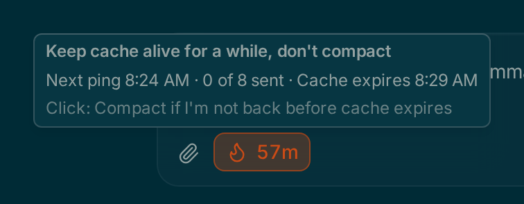</td>
    <td width="33%">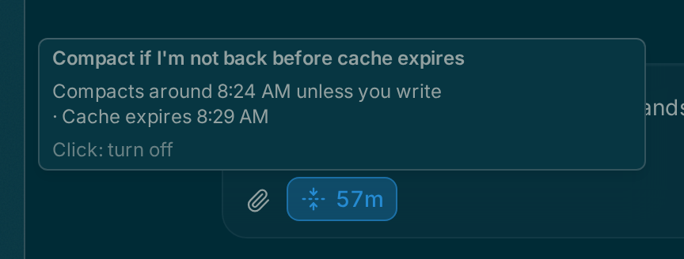</td>
    <td width="33%">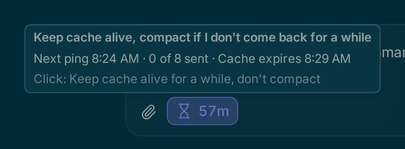</td>
  </tr>
  <tr>
    <td valign="top"><b>1 · Keep cache warm</b> <sub>(orange flame)</sub></td>
    <td valign="top"><b>2 · Compact before the cache expires</b> <sub>(blue)</sub></td>
    <td valign="top"><b>3 · Keep cache warm, then compact</b> <sub>(violet)</sub></td>
  </tr>
</table>

**1. Keep cache warm** (orange). About five minutes before the cache would expire, the server sends the thread a short ping asking Claude to reply "ok", which starts a fresh hour. The five-minute lead leaves room for Claude Code to restart after a long idle, since a ping that lands after expiry is the most expensive outcome. After **8 pings in a row** with no message from you (about 8 hours), keep-warm pauses; your next message, or clicking the button again, resumes it. Each ping is a small turn that reads the context from the cache, so it uses a little of your limits.
_Use it when_ you'll be back within a few hours and want the full, uncompacted context waiting for you.

**2. Compact before the cache expires** (blue). No pings. About five minutes before the cache would expire, the server sends `/compact` while the history is still cached. The summary is cheap to make from a warm cache, and your next message starts from the small summary instead of re-reading the whole history uncached. It compacts once per idle stretch; your next message starts a new one.
_Use it when_ you're done for now but want resuming later to be cheap.

**3. Keep cache warm, then compact** (violet). Pings like mode 1 while the 8-ping budget lasts, then compacts before the last cache expires instead of letting it lapse.
_Use it when_ you want both: the full context for a working session, and a cheap summary if you don't come back.

The rules all three modes share:

- Pings and compactions never interrupt a running turn or a question waiting on you. Settled, snoozed and archived threads are skipped.
- If the cache has already expired, nothing is sent until your next message, because rebuilding the cache costs the same either way.
- A compaction shows in the thread as a `/compact` turn sent by T3 Code. It is skipped when the thread's last turn was already a compaction.
- Agents can pick a mode for any thread with the `t3_thread_organize` MCP tool (`keep_cache_warm`, `compact_before_cache_expires`, `keep_cache_warm_then_compact`).
- While an agent is babysitting background subagents with a 15-minute heartbeat, the button shows as on even if you never turned it on, because each check-in refreshes the cache. That stops by itself when the subagents finish.

**Prompt cache reminders.** Separately, when an idle Claude conversation with at least 100k tokens of context is 10 minutes from losing its cache, T3 Code shows a banner linking to it. Turn the banners off or change the size threshold in **Settings → General**. Full details: [Claude provider docs](./docs/user/providers-claude.md#keep-cache-warm).

### 🎨 Selectable color themes

A **color scheme** axis that is independent of the light/dark toggle. Pick from **Solarized, Dracula, Gruvbox, Catppuccin, and Tokyo Night** — each ships a full light _and_ dark variant — or stay on Default. The scheme re-tints the whole app (sidebar, chat, header) and is applied before first paint, so there's no flash, and it syncs across browser tabs.

Set it in **Settings → General**, right below the light/dark **Theme** control:

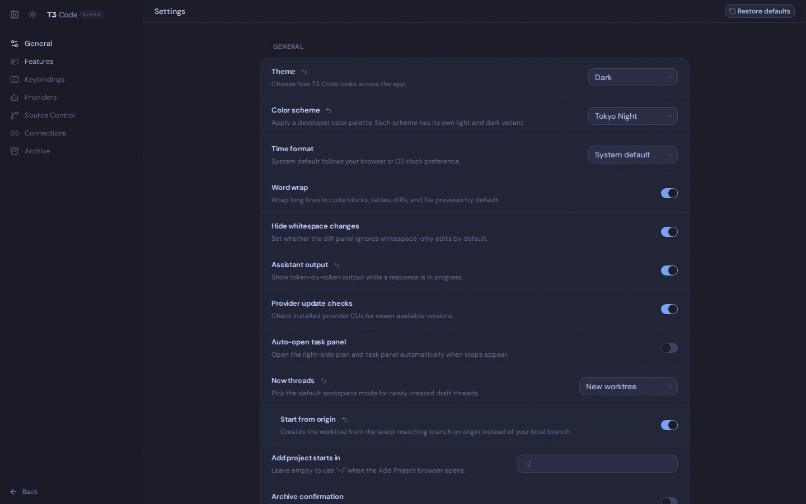

<table>
  <tr>
    <td width="50%">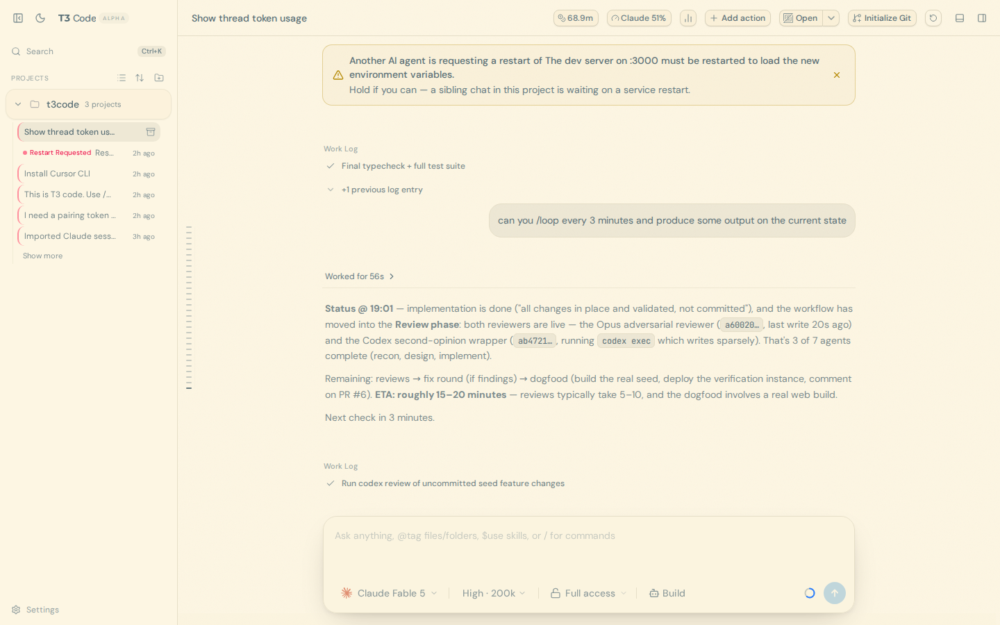<br/><sub><b>Solarized · Light</b></sub></td>
    <td width="50%">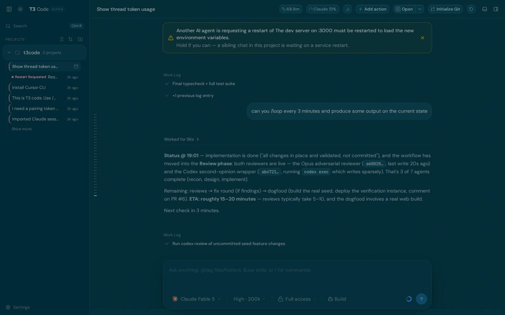<br/><sub><b>Solarized · Dark</b></sub></td>
  </tr>
  <tr>
    <td width="50%">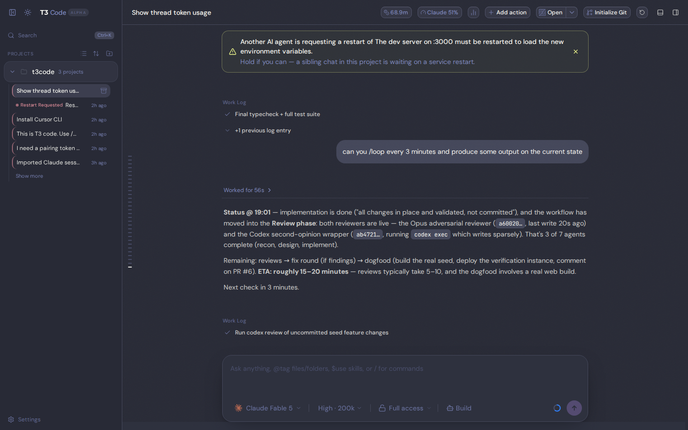<br/><sub><b>Dracula</b></sub></td>
    <td width="50%">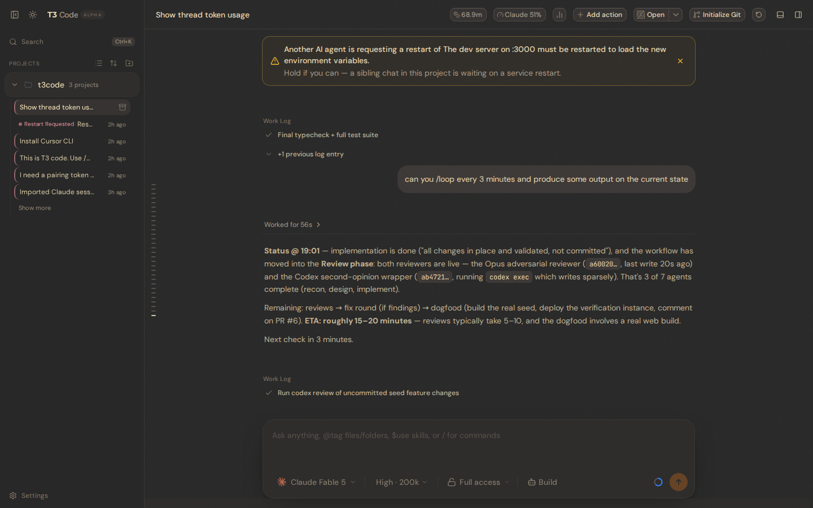<br/><sub><b>Gruvbox</b></sub></td>
  </tr>
  <tr>
    <td width="50%">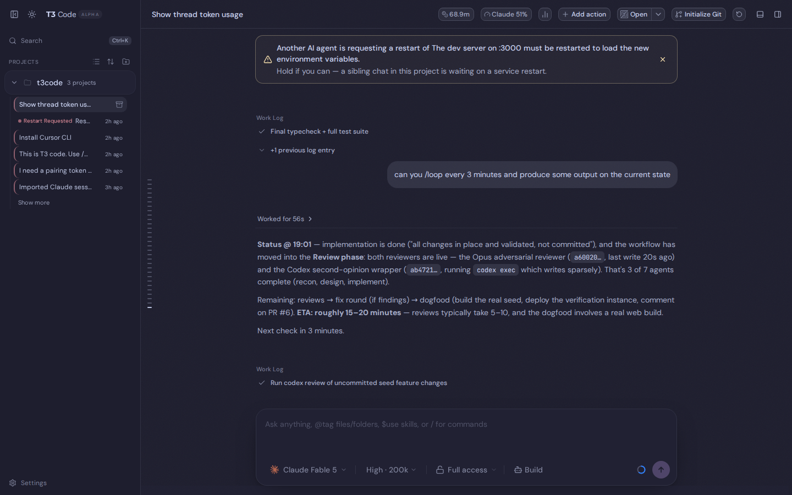<br/><sub><b>Catppuccin</b></sub></td>
    <td width="50%">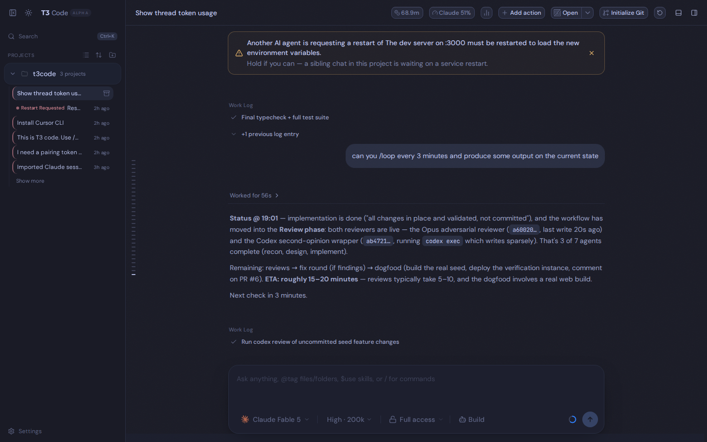<br/><sub><b>Tokyo Night</b></sub></td>
  </tr>
</table>

### 📊 Usage, spend & token meters in the header

Keep an eye on how much you're burning without leaving the chat. Small chips in the top bar always show the thread's **token usage** and your **Claude plan usage**. A bar-chart menu lets you switch on larger, color-coded readouts per device: **Context window**, **Spend estimate**, **Claude Session %**, **Claude Weekly %** (plus a Fable-only weekly), **Codex subscription %**, **Gemini session and weekly %**, and a **stock ticker** for the symbols you type in (comma-separated; with several, the ticker cycles through them every 5 seconds). Hovering a usage tile shows a countdown to when that limit window resets.

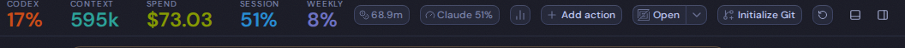

The **Codex** meter reads your Codex CLI subscription's rate-limit usage passively from local rollout files — no extra API calls — so it even reflects out-of-band `codex exec` runs. The stock ticker shows the overnight (24/5) price outside market hours. The small chips hide themselves while the matching large readout is on. Toggle any stat from the header menu:

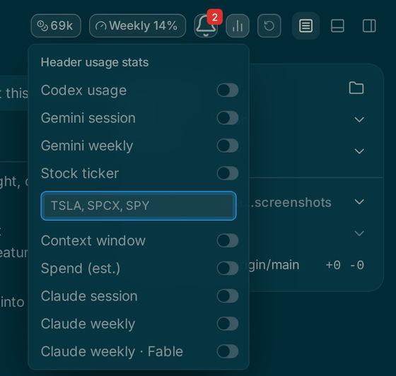

### 🧱 Tile wall of live chats

Press **Ctrl+Alt+Shift+W** to open a full-screen wall with every unsettled thread as a live tile. Each tile has its own scrolling timeline and its own composer, so you can drive many conversations side by side on a big monitor. Tile headers are color-coded by state (waiting on you, running, done, failed) and show the project and token count. Each tile has its own **Snooze** and **Settle** buttons. Drag tiles to reorder them, and pick the grid size (2 × 2, 3 × 2, …) from the layout menu in the top-right corner. Order and layout are remembered per device.

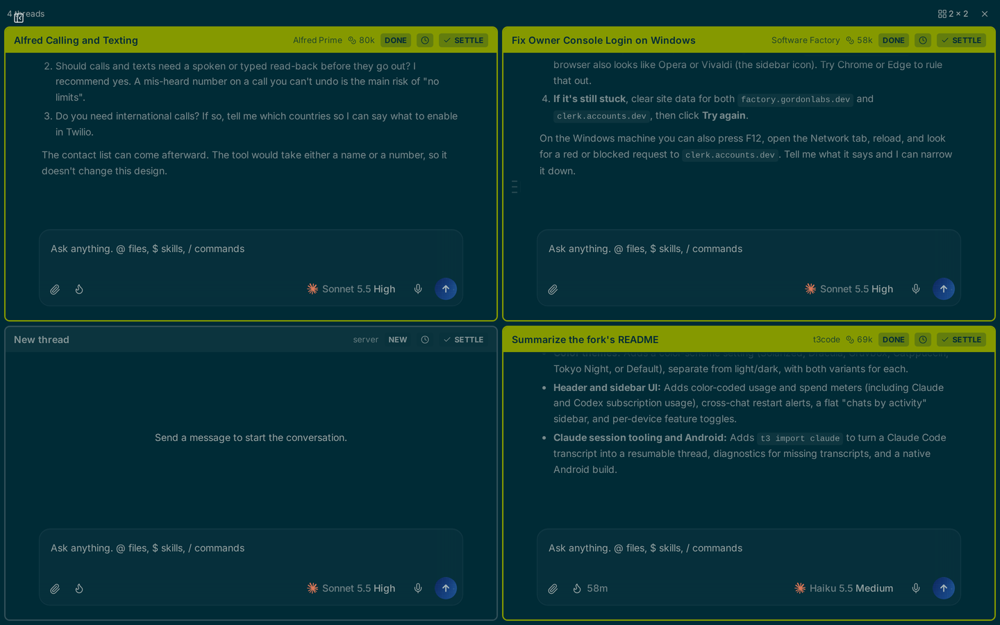

### 🚗 Touch / car layout

A layout for touch screens you mostly talk to: a car display (built and tested on a Tesla Model Y's in-car browser), a tablet, or a phone. You get bigger buttons, a large **Speak** button on the left (the driver's side), and the rarely-changed composer controls folded into one **⋯** menu. Swipe and press-and-hold gestures replace small hover buttons: two-finger swipes start new chats in your project slots, a three-finger tap opens the project list, and a four-finger tap shows all projects full screen. The ⋯ menu lists every gesture. An automatic compact "drive" density kicks in at car-browser widths, so the primary controls fit the 773 × 601 driving viewport without scrolling.

Turn it on in **Settings → Fork Features → Touch / car layout**. Phones get it automatically, and you can switch that off. **Keyboard on demand** stops a tap on the message box from opening the on-screen keyboard; a keyboard button next to the mic does that instead.

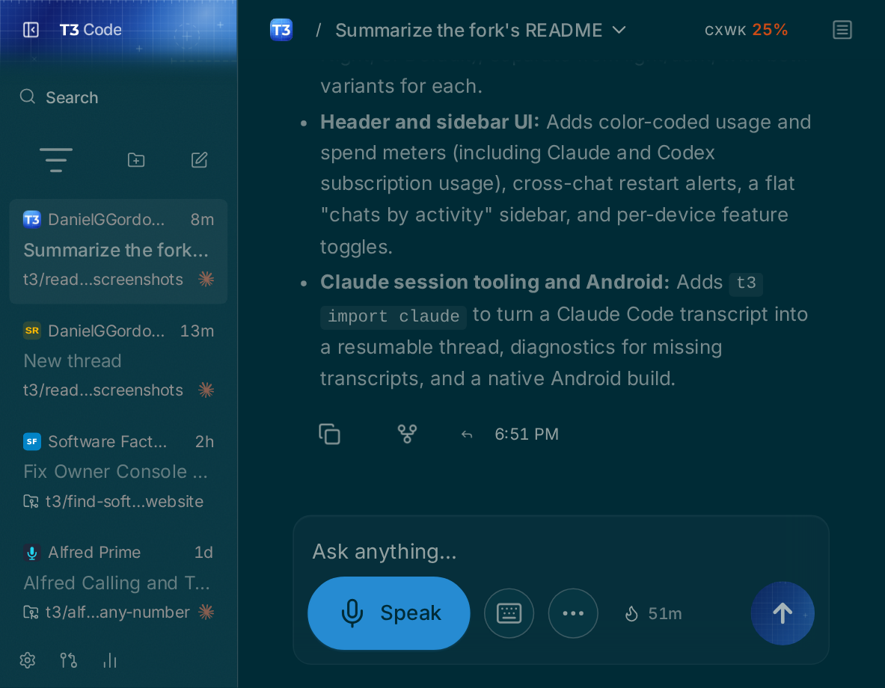

### 🎙️ Server-side voice input

The composer's mic button records a clip and has **your T3 server** transcribe it, using a self-hosted Whisper server (free, and the audio stays on your machine), OpenAI, or both with one as fallback. It transcribes while you talk, cutting the recording at pauses, so when you stop only the last few seconds are left to process. Stop with **✓** to put the text in the composer for editing, **↑** to send it straight away, or **✕** to discard it. You can give the server a vocabulary prompt for names and jargon it keeps mishearing. Setup: [voice input docs](./docs/user/voice-input.md#quick-voice-button-server-whisper-or-openai).

### 🔔 Notifications from outside services

Outside services can push **notification cards** into T3 Code over an authenticated HTTP API: a held Slack message waiting for approval, a failed nightly build, anything a person should see. Every connected client shows the open cards live under a bell in the chat header, with a toast when one arrives. A card can carry up to four buttons; clicking one sends a signed callback to the service, which decides what happens. Dismissing a card, or the service resolving it, clears it everywhere. **Dismiss all** clears them in one go. T3 Code also raises its own cards for security events (see [two-factor](#-session-two-factor-and-new-device-alerts)). Contract and setup: [notifications API](./docs/user/notifications-api.md).

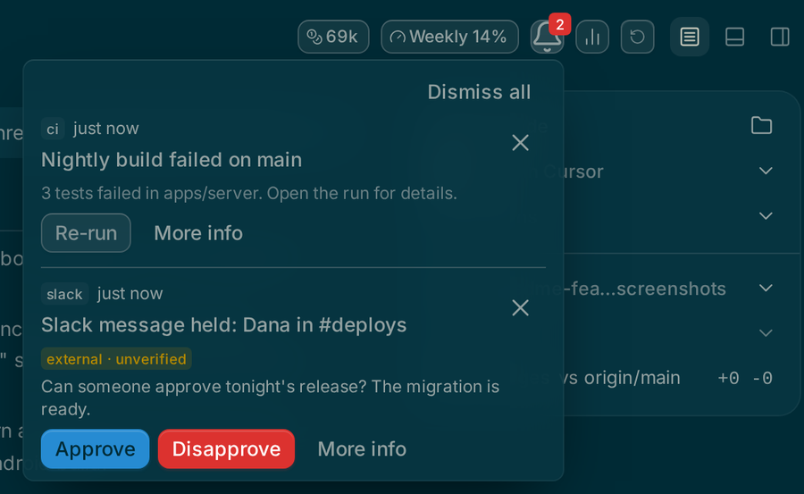

### 🔁 Cross-chat AI restart alerts

When an agent asks you to restart the service it's working on, T3 Code surfaces it so your _other_ chats on the same project don't stomp on the restart. The requesting chat gets a banner with a **Mark resolved** action, its sidebar row shows a **Restart Requested** pill, and sibling chats get a "hold" banner. It auto-clears when you reply in the requesting chat.

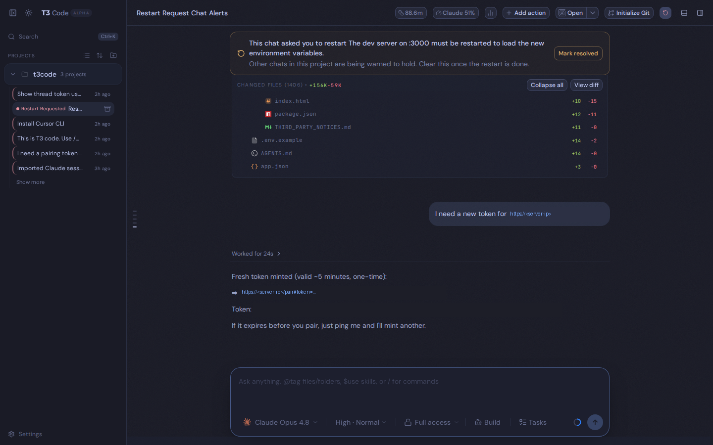

### 🗂️ "Chats by activity" sidebar

Flip the sidebar from the grouped project tree into a single flat list of every chat, ordered by last activity, with each row tagged by its project. The choice persists per device.

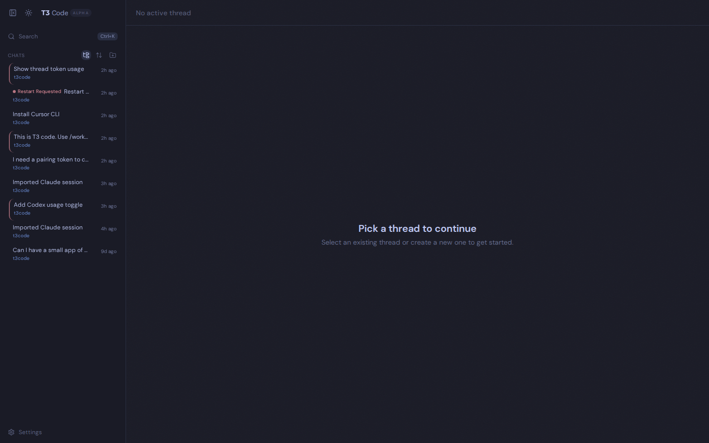

### ⌨️ Shortcut extras

- **Two-key chords** such as `ctrl+e s`: press Ctrl+E, let go, then press S. Record them in **Settings → Keybindings** like any other shortcut. The first key must include Ctrl, Alt or Cmd, so a chord never swallows ordinary typing. See [keybindings](./docs/user/keybindings.md#two-key-chords).
- **Show my shortcuts**: a popup listing the shortcuts you actually have bound. Open it from the command palette (Ctrl+K) or bind it to a key.
- **Project-slot shortcuts**: bind keys that start a new thread in one of three projects you pick under **Settings → Keybindings → Project shortcuts**.
- **Snooze for an hour**: one key snoozes the current thread for an hour, or wakes it if it's already snoozed.

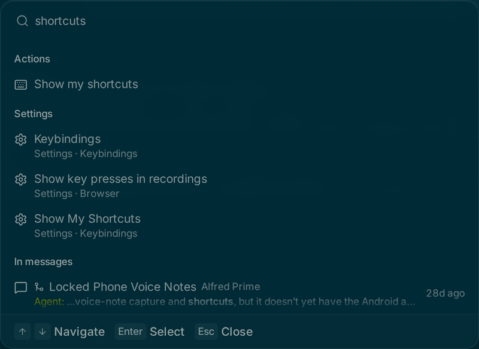

### 🖥️ Server load in the sidebar

A compact **CPU and memory** readout for the machine running the T3 server, next to Settings at the bottom of the sidebar. It refreshes every few seconds while it's on screen, which is handy when agents are running builds on a shared box. Turn it on, and pick its style, in **Settings → Fork Features → Server load**.

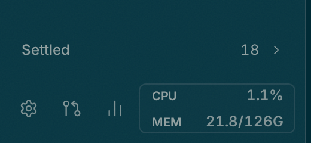

### 🔐 Session two-factor and new-device alerts

Once you enable two-factor authentication, every browser session must enter a code from your authenticator app (or a recovery code) **every 48 hours**. A leaked or forgotten session cookie stops working on its own. Sessions issued locally on the server host are exempt. Separately, the server raises a security alert whenever a **new device pairs** or an existing session **connects from a new IP**. The alert shows up as a notification card in T3 Code with a reminder of where to revoke the session, and can also go to a Slack-style webhook (`T3CODE_SECURITY_ALERT_WEBHOOK_URL`) or a shell command (`T3CODE_SECURITY_ALERT_COMMAND`).

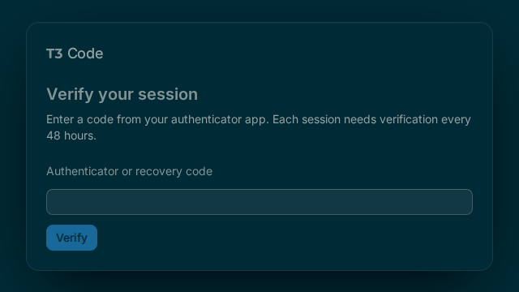

### ⚙️ Per-device feature toggles

A **Settings → Fork Features** page gathers the fork's per-device switches: auto/show/hide for the chat header's Git actions, Open in editor, Project scripts and Notifications bell; hiding the composer's access-mode selector; the touch / car layout and keyboard on demand; dotfiles and the open-in-editor button in the file explorer; and the server-load readout. "Auto" shows a control on desktop-width screens and hides it on phones and in the touch / car layout. Stored per device.

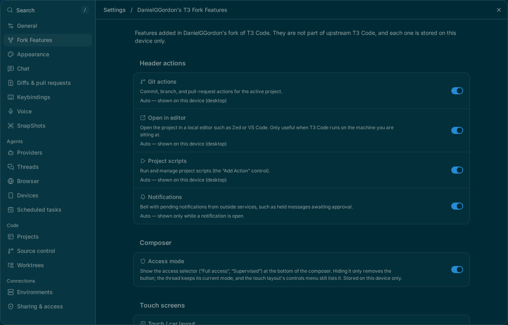

### And more

- **Titles that follow the conversation** — thread titles are shorter, and a thread is re-titled on its second message so the title reflects what the chat turned into, not just its opening line.
- **Hide or archive projects from the pickers** — hidden and archived projects stay out of the project selector until you search for them, and the new-thread button starts a thread in the current project in one step.
- **Project skills in the composer's slash menu**, alongside the built-in commands.
- **File explorer upgrades** — show dotfiles, change the explorer's root folder, and an invert toggle that flips the file viewer to the opposite light/dark theme. The explorer is collapsed by default.
- **Slack-thread badge** — threads that came from a Slack thread show the Slack mark at the start of their title in the sidebar, instead of a literal `Slack:` prefix.
- **Latest Claude models** — Claude Opus 5.5, Sonnet 5.5 and Fable are in the built-in model list, and new sessions default to Claude Sonnet 5.5.
- **`t3 freeze` / `t3 thaw`** — pause every other conversation and scheduled task on the server so one long task is the only thing using your Claude subscription while you measure it, then put everything back exactly as it was.
- **Automatic Claude Code transcript sync** — `t3 import sync` (run every 15 minutes by a systemd timer on the host) mirrors every Claude Code transcript into T3 as a backdated, resumable thread. It skips sessions T3 spawned itself and copies it already has, and respects threads you've deleted.
- **Resumable Claude Code conversation import** — `t3 import claude <session>` turns an existing Claude Code transcript into a resumable T3 thread, forking to a new transcript so your original session is untouched.
- **Missing-transcript diagnostics** — when a Claude thread can no longer be resumed because its `~/.claude/projects/…/<session>.jsonl` is gone (host reprovisioned, thread imported from another machine), the thread shows exactly which file is missing instead of a generic stream failure. `t3 session audit` lists every affected thread with the path to restore; `t3 session reset <threadId> --yes` is the explicit opt-in to start that thread over with a fresh Claude session.
- **Android app** — a full native Android build (Ghostty terminal, Shiki-highlighted code blocks, themed native chrome, self-signed-TLS trust, sideload APK publish script).
- **File explorer collapsed by default**, and a fix so the **left edge of message lines is selectable**.

## Documentation

- [Install and first run](./docs/user/install.md)
- [Remote access from a phone or another machine](./docs/user/remote-access.md)
- [Permission modes](./docs/user/permission-modes.md)
- [Source control](./docs/user/source-control.md)
- [Connect outside agents over MCP](./docs/user/outside-agents.md)
- [FAQ](./docs/user/faq.md)

[All docs](./docs/README.md) has the full list.

## Contributing

We have limited review capacity. Small, focused fixes are the most likely to be merged. Features need an approved discussion first.

- Read [CONTRIBUTING.md](./CONTRIBUTING.md) before you report a bug or open a pull request.
- Put feature requests in [Ideas](https://github.com/pingdotgg/t3code/discussions/categories/ideas).
- Build from source with the [development runbook](./docs/operations/development.md#first-checkout). The [architecture overview](./docs/internals/overview.md) explains how it works.
- Get help in [Discord](https://discord.gg/jn4EGJjrvv).

## License

[MIT](./LICENSE)
